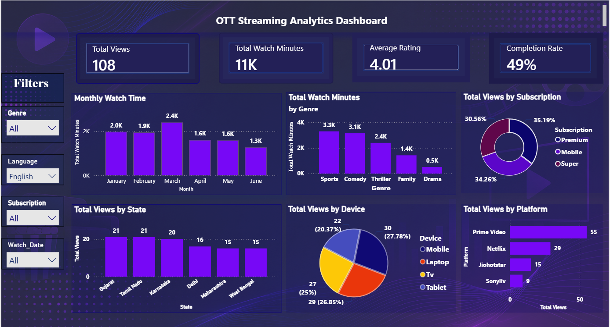

# 🎬 OTT Streaming Analytics | Power BI

A Data Analytics project created using Power BI to analyze OTT streaming data across views, watch time, ratings, genres, subscriptions, devices, states, and platforms.

## 📊 Dashboard Preview

### OTT Streaming Analytics Dashboard

## 🎯 Objective

To analyze OTT viewing data and create an interactive Power BI dashboard to understand viewer engagement, content performance, and viewing patterns.

## 🛠️ Tools Used

- Power BI
- Power Query
- DAX
- Data Modeling

## 🔄 What I Did

- Understood the business requirements
- Prepared and cleaned the data using Power Query
- Built the data model in Power BI
- Created DAX measures for key KPIs
- Designed an interactive Power BI dashboard
- Analyzed watch time, views, ratings, genres, subscriptions, devices, states, and platforms
- Created insights from the analysis

## 📈 Key KPIs

- Total Views: **108**
- Total Watch Minutes: **11K**
- Average Rating: **4.01**
- Completion Rate: **49%**

## 🔍 Key Insights

- **March** had the highest monthly watch time at approximately **2.4K minutes**.
- **Sports** had the highest watch time among the genres shown at approximately **3.3K minutes**.
- **Prime Video** had the highest number of views among the platforms shown, with **55 views**.
- **Premium** had the highest share of views among the subscription types shown at **35.19%**.
- **Gujarat** and **Tamil Nadu** had the highest views among the states shown, with **21 views each**.
- **Mobile** was the most-used device among the devices shown, with **30 views**.

## 📂 Project Files

- `OTT_Streaming_Analytics.pbix` — Power BI dashboard
- `OTT_Streaming_BRD_Portfolio.pptx` — Business requirements
- `Shows.xlsx` — Show details data
- `Watch_History.xlsx` — Viewing history data

## 👤 About

**Mansi Shirsat**

Aspiring Data Analyst

**Project Focus:** Power BI | Data Analysis
